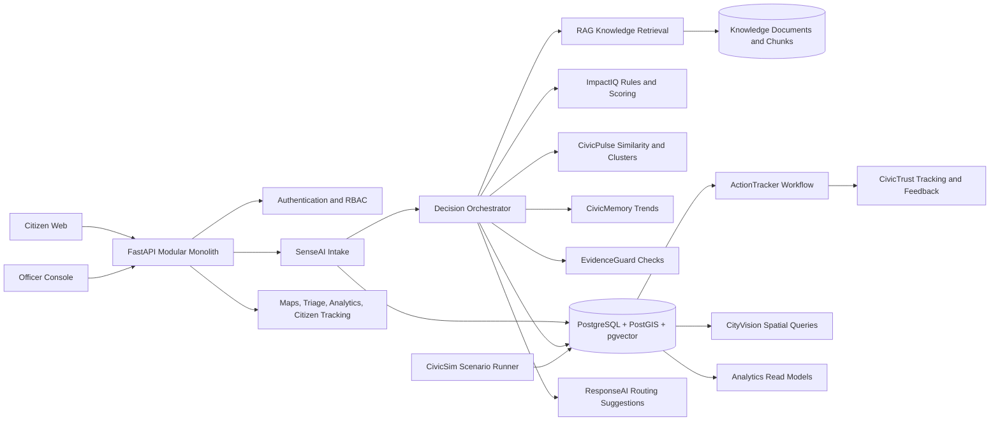
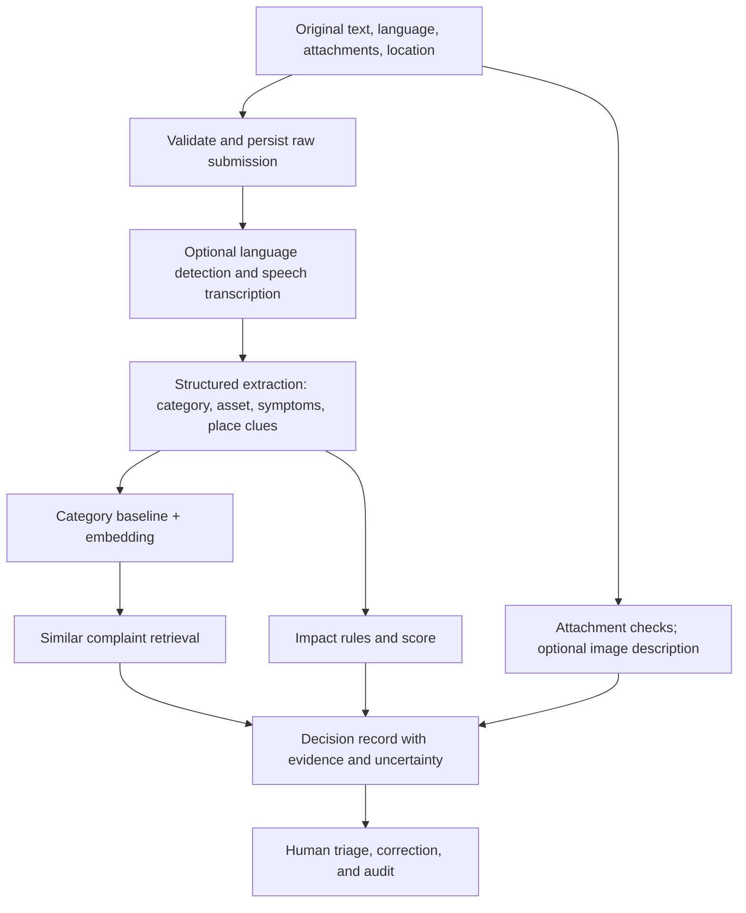
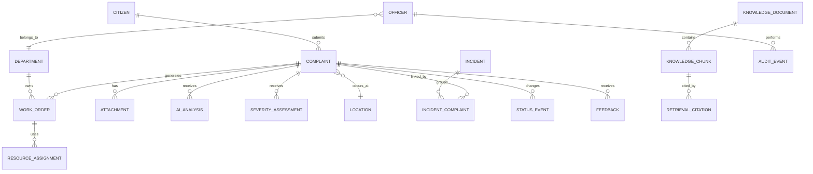

# CivicLens — Phase 01 Engineering Blueprint

**Status:** Architecture baseline for a hackathon prototype  
**Scope:** Design only. This phase does not create application code or claim access to municipal systems.

## 1. Executive recommendation

Build CivicLens as a **modular monolith**: one React/TypeScript web client, one FastAPI application, and one PostgreSQL database. Use PostGIS for spatial data and pgvector for embeddings where the selected database host supports both extensions. Keep the ML, retrieval, decision, and workflow logic behind explicit Python module interfaces inside the backend. Start with a deterministic, inspectable pipeline and a curated synthetic/demo dataset; add hosted multimodal LLM calls only as an optional adapter.

This gives the demo one coherent complaint record and audit trail while keeping the modules independently replaceable. It avoids distributed service operations and external vector infrastructure before traffic or team size justifies them.

### What the prototype can credibly demonstrate

- Citizen complaint submission with text, optional image, language, time, and map-selected location.
- Category suggestions, extracted fields, uncertainty, and explainable priority factors.
- Similar-complaint suggestions and deterministic time/distance clusters.
- Jurisdiction/departments and SOP retrieval from a small, curated knowledge base.
- Officer triage, assignment, status history, SLA indicators, and citizen-facing tracking.
- Basic maps, aggregate dashboard metrics, recurring-pattern views, and a controlled simulation.

### What remains a controlled demonstration

- Multilingual quality beyond the specific languages exercised in the demo.
- Image hazard interpretation and voice transcription, both of which require provider/model evaluation and human confirmation.
- Citywide hotspot forecasts, incident causation, resource optimization, and verified resolution. These need reliable historical, operational, and ground-truth data not assumed to exist.
- Authentic jurisdiction, SOPs, department capacity, and infrastructure records. Demo records must be labeled synthetic or illustrative.

## 2. Architecture and module boundaries



### Shared record and module contracts

Every module operates on stable IDs and returns a versioned result with `source`, `created_at`, `model_or_rule_version`, `confidence` where meaningful, and references to supporting records. Preserve the citizen's original submission, attachment metadata, and location separately from derived fields. Derived analysis is append-only by version; a human correction records the actor, time, old/new values, reason, and whether the correction supersedes a suggestion.

| Module | Responsibility and bounded output |
|---|---|
| SenseAI | Normalize language/transcript, extract candidate category/location/asset/symptoms, summarize image with provider if configured; return evidence spans and uncertainty. Never silently rewrite the original. |
| ImpactIQ | Apply safety rules and a transparent weighted score; return factors, rule hits, priority band, and escalation state. |
| CivicPulse | Retrieve candidate similar complaints; score text and spatial/temporal proximity; propose duplicate links or incident membership for review. |
| CityVision | Geospatial filters, map features, jurisdiction lookup, density aggregation. No invented infrastructure context. |
| ResponseAI | Suggest department and next actions grounded in retrieved documents; return citations and confidence; officer approves. |
| ActionTracker | Assignment, status transition, due dates, work orders, SLA clock, resolution evidence, audit trail. |
| CivicMemory | Aggregate recurring categories, places, and time windows; expose counts and provenance, not causal claims. |
| CivicSim | Run scenario calculations against explicit assumptions and demo data; label outputs hypothetical. |
| EvidenceGuard | Basic file validation, perceptual-hash duplicate candidate detection, attachment-to-complaint relevance review queue. Not a fraud detector. |
| CivicTrust | Citizen status view, feedback, and optional corroboration. Protect identities and prevent public exposure of sensitive reports. |
| Analytics | Query approved aggregates and operational metrics; avoid exposing personally identifying data. |

## 3. Technology stack

| Area | Recommendation | Why / constraints |
|---|---|---|
| Frontend | React, TypeScript, Vite | Familiar, fast prototype cycle; typed API contracts reduce integration drift. |
| UI | Tailwind CSS, a small accessible component set, Framer Motion sparingly | Styling consistency and useful transitions without making animation core to the workflow. Respect reduced-motion preferences. |
| Charts and maps | Recharts; Leaflet with OpenStreetMap-compatible tiles | Good for a demo. Confirm tile provider terms and attribution; do not assume free tiles are a production service. |
| Backend | Python 3.12+, FastAPI, Pydantic | Typed request/response validation and a clear REST boundary; keep domain logic out of route handlers. |
| Persistence | PostgreSQL; PostGIS and pgvector extensions | One source of truth for transactional, spatial, and small-to-medium vector retrieval needs. Verify extension availability on the chosen host before committing. Supabase is a reasonable managed option if its current plan, region, extension availability, storage, auth, and data-residency needs fit. |
| ORM/migrations | SQLAlchemy 2 + Alembic | Explicit schema evolution and maintainable relational mapping. Use SQL for specialized PostGIS/vector queries. |
| ML | scikit-learn baseline; Sentence Transformers for embeddings; optional Hugging Face inference | Start with curated taxonomy, TF-IDF/linear classifier, and multilingual embedding evaluation. Avoid training deep models on tiny noisy data. |
| LLM / vision | Provider adapter for Gemini or another approved multimodal API; strict JSON schema and timeout | Treat as an optional, replaceable service. Send minimum necessary data, never secrets, and provide deterministic fallback if unavailable. Verify current provider retention, region, and limits before use. |
| File storage | Private object storage (Supabase Storage or equivalent) with short-lived signed access | Keep binary files out of relational rows; persist metadata and checksums. Development can use local private storage. |
| Background work | Start with FastAPI background task for short demo jobs; add a single Redis-backed worker only for long-running ingestion/transcription | No queue infrastructure until latency or reliability requires it. Do not run long ML inference inside a request indefinitely. |
| Deployment | One frontend host, one API service, managed Postgres, environment-based config | Keep the deployment explainable and easy to reset for a hackathon. |

**Stack caveats:** Leaflet is a map renderer, not authoritative boundary data. Hosted PostgreSQL extension support differs by provider. Supabase can reduce setup work but does not remove the need to design authorization, backups, migrations, privacy, and API boundaries. Use managed auth or an OIDC provider rather than implementing password cryptography in the demo.

## 4. AI/ML pipeline



### Practical model choices

1. **Category classification:** Define a small civic taxonomy (e.g., roads, drainage/flooding, waste, water, streetlight, sanitation, public safety, other). For phase 1, use a curated seed set with TF-IDF + logistic regression or linear SVM as a baseline, plus rules for critical keywords. Display top candidates and confidence; collect corrections. Only train/evaluate once labels are reviewed. A pretrained multilingual encoder can be evaluated later, but model quality must be measured on the actual language mix.
2. **Semantic similarity:** Evaluate `sentence-transformers/paraphrase-multilingual-MiniLM-L12-v2` or another current multilingual retrieval model against a small hand-authored test set of paraphrase pairs. Use cosine similarity for candidate ranking, not as proof of duplication. Thresholds need calibration by category and location.
3. **Duplicate detection:** Combine text similarity with distance, time window, category, and optional asset identity. Apply hard exclusions and return candidates for review. Two reports can describe the same incident with different words; similar reports can also describe separate events.
4. **Clustering:** Begin with deterministic distance/time/category grouping (e.g. DBSCAN after projecting coordinates locally) or connected components over reviewed duplicate links. Use HDBSCAN only if a real dataset justifies its extra tuning. Do not call clusters verified incidents until a person confirms them.
5. **Recurring patterns:** Aggregate counts by category, grid/jurisdiction, and time window; use historical comparisons only when adequate baselines exist. Prototype results are descriptive, not forecasts.
6. **Image/audio:** Initially validate and store files; optionally use provider vision or speech-to-text behind an adapter. Ask the citizen/officer to confirm extracted facts. Duplicate-photo detection can use file hashes and perceptual hashes. Avoid face recognition and claims about identity or intent.

### Decision layer and safety

- **Verified facts:** user-entered values, officer-confirmed edits, timestamps, coordinates with stated precision, and explicitly loaded jurisdiction/SOP records.
- **Model predictions:** category, language, extracted fields, similarity, and image descriptions. Store model/version/confidence and evidence references.
- **Recommendations:** priority explanations, department routing, action plan, and resource suggestions. Store grounding document IDs and mark as unapproved until officer action.
- **Rules:** implement explicit urgent hazard triggers (for example, reported live electrical wire, active fire, collapse, or immediate danger) as deterministic escalation flags. Show the trigger and prescribed escalation guidance sourced from approved local policy. Do not wait for an LLM. Since local emergency contacts/policies are unknown, seed them only with clearly labeled demo content until an authorized source is supplied.
- **Uncertainty:** low confidence or conflicting fields should prompt a clarification or human review. No auto-close, denial, or penalty based on model output.
- **Fallback:** if embeddings/provider calls fail, accept and queue complaint, apply deterministic safety rules, and let staff classify manually. Never fabricate a department, jurisdiction, SOP, or estimated resolution.

## 5. RAG architecture and workflow

**Knowledge sources for the demo:** hand-authored, clearly labeled sample department remit, SOP, escalation policy, maintenance checklist, and synthetic jurisdiction mapping. In a real deployment these must be approved, versioned sources supplied by the municipality.

1. Ingest only authorized documents; record source, owner, jurisdiction, effective date, version, access scope, and checksum.
2. Extract text while retaining page/section references. Split by headings and procedure boundaries into roughly 300–700 token chunks with small overlap; preserve title, section, document ID, department, jurisdiction, valid dates, and sensitivity metadata.
3. Embed chunks using one evaluated multilingual model, stored in pgvector alongside metadata. Keep the embedding model/version recorded so re-embedding is controlled.
4. At query time, determine allowed jurisdiction/department and effective-date filters first; create query embedding; retrieve a small top-k set using metadata filtering and vector similarity, optionally combine PostgreSQL full-text search for exact policy terms; rerank only if evaluation shows benefit.
5. Give the answer generator only retrieved chunks and structured complaint facts. Require structured output with recommendation, rationale, cited chunk IDs, and `insufficient_evidence` state. Reject citations that do not map to retrieved chunks.
6. Display source title/section and quote-sized evidence to the officer. Store retrieval IDs, scores, model/version, prompt version, and generated recommendation for audit.

**Recommendation:** pgvector is sufficient for an initial corpus. PostgreSQL supports exact search and approximate HNSW/IVFFlat indexes; exact search is the simplest baseline at small scale. HNSW trades memory/build time for a useful speed/recall balance. Begin without approximate indexing, measure, then add HNSW only when needed. Metadata filters and authorization must be applied as part of retrieval, not after exposing results. A separate vector database is not justified for this phase.

## 6. Data model

Use UUID primary keys, UTC timestamps, explicit enum/status values, and soft archival where retention policy requires it. Store original submitted content immutably; keep personal data in separately permissioned records. Avoid putting names, phone numbers, or exact citizen addresses in embeddings or analytics.



| Entity | Key fields / relationships |
|---|---|
| `citizens` | Auth subject ID, optional contact reference, privacy/consent flags; avoid duplicating identity-provider secrets. |
| `officers` | Auth subject ID, department, role, active state. |
| `departments` | Name, code, remit, jurisdiction IDs, contact/escalation configuration with source/version. |
| `complaints` | Submitter (nullable for anonymous), original text, original language, created time, category (user-asserted or confirmed), current status, visibility, location ID, intake channel. Preserve original text independently. |
| `attachments` | Complaint ID, private object key, media type, byte size, checksum, perceptual hash optional, scan state, consent/retention metadata. |
| `locations` | Point geometry/geography, optional accuracy radius, citizen-provided place text, geocoding source/status, jurisdiction ID. Never imply GPS precision not provided. |
| `ai_analyses` | Complaint ID, module, schema/model/prompt version, output JSON, confidence, evidence spans, status, error details, created time. Append versions. |
| `severity_assessments` | Complaint ID, ruleset version, factors, score/band, hazard flags, reviewer override and reason. Keep score and override distinct. |
| `incidents` / `incident_complaints` | Incident label/status and many-to-many links with match method/score, reviewer, review status. |
| `knowledge_documents` / `knowledge_chunks` | Source, owner, jurisdiction, department, effective dates, version, checksum, sensitivity, chunk text, section/page, embedding model and vector. |
| `work_orders` | Complaint, department, assigned officer, priority, due time, resolution note/evidence, completion and verification states. |
| `resource_assignments` | Work order, resource type/quantity, time window, assumptions; simulation records separated from real assignments. |
| `status_events` | Complaint/work order, old/new status, actor, timestamp, reason, visibility. Append-only. |
| `feedback` | Complaint, rating/comment, submitter or anonymous token, moderation/visibility state. |
| `audit_events` | Actor, action, entity, before/after reference or diff, timestamp, request ID, reason; restrict access and avoid unnecessary sensitive payload copies. |
| `retrieval_citations` | Analysis/result ID, chunk ID, rank, score, displayed citation and retrieval timestamp. |

**Indexing:** B-tree on complaint status, category, department, created time, assigned officer, and foreign keys; composite `(status, created_at)` and `(department_id, status, created_at)` for triage. GiST on PostGIS point/boundary geometry. GIN on carefully selected JSONB/full-text columns only. pgvector HNSW only after measuring the demo corpus and recall. Add uniqueness for external/auth IDs and checks for allowed statuses, coordinate ranges, and nonnegative quantities. Partitioning is unnecessary at prototype scale.

## 7. Backend REST API structure

Version under `/api/v1`; publish OpenAPI; use Pydantic schemas and consistent error envelopes. Enforce authorization at every endpoint and query boundary.

| Router | Example resources/actions |
|---|---|
| `/auth` | Current user/profile; rely on managed OIDC/Supabase Auth integration. |
| `/complaints` | Create, citizen list/detail, attachment upload handshake, citizen tracking. |
| `/officer/triage` | Queue filters, detail, claim/assign, confirm category/location, override priority. |
| `/complaints/{id}/analysis` | Request/inspect AI analysis; expose model provenance and human-review state. |
| `/incidents` | Candidate matches, create/merge/split with audit, complaint memberships. |
| `/work-orders` | Create, assign, transition status, resolve, verify. |
| `/departments` and `/jurisdictions` | Read approved configuration and boundaries. |
| `/knowledge` | Restricted document/chunk management, ingestion status, retrieval preview for admins. |
| `/map` | Bounding box, time/category/status filters, privacy-safe aggregated features. |
| `/analytics` | Aggregated operational counts, trends, SLA and department performance. |
| `/simulations` | Run/read explicitly hypothetical scenario with input assumptions. |
| `/feedback` | Submit and moderate feedback/corroboration. |

Use idempotency keys for complaint creation and uploads; pagination/filter limits; rate limits for public endpoints; request IDs; file upload presigned URLs; explicit allowed state transitions. Long-running analysis should return a job/result state and remain retryable.

## 8. Frontend page and component architecture

**Citizen flow:** landing/report issue → form (description, language, map pin, optional image/audio) → review extracted details → submission receipt/tracking → status and feedback.

**Officer flow:** sign-in → triage queue → complaint detail (original evidence, map, AI suggestions with source/confidence, history) → human review/assignment → work order/status update → verify and close.

**Operations:** city map with filters and privacy-safe clusters; dashboard with aggregate counts/SLA/trends; knowledge/admin page for demo policy records; simulation page showing assumptions and hypothetical results.

Suggested frontend folders: `app/` route shell, `features/complaints`, `features/triage`, `features/map`, `features/analytics`, `features/knowledge`, `features/simulations`, `components/`, `api/` typed client, `auth/`, `hooks/`, `types/`. Keep module names aligned to user workflows, not one dashboard per AI label. Component essentials: `ComplaintForm`, `LocationPicker`, `AttachmentPicker`, `PriorityBadge` with factors, `EvidencePanel`, `SimilarComplaints`, `AssignmentPanel`, `StatusTimeline`, `MapLayerControls`, `MetricCard`, and accessible loading/error/empty states.

## 9. Proposed project structure

```text
civiclens/
  docs/
    CIVICLENS_PHASE_01_BLUEPRINT.md
    decisions/
  frontend/
    src/{app,api,auth,components,features,hooks,types}/
  backend/
    app/
      api/v1/
      core/                 # settings, security, logging
      db/                   # session, models, migrations
      domain/                # entities, enums, state transitions
      modules/
        sense_ai/ impact_iq/ civic_pulse/ city_vision/ response_ai/
        action_tracker/ civic_memory/ civic_sim/ evidence_guard/
        civic_trust/ analytics/ knowledge_rag/
      integrations/          # LLM, embeddings, object storage
    data/demo/               # synthetic seed data only
  knowledge/demo/            # labeled sample SOPs and department remit
  infrastructure/            # local development config and deployment notes
  .env.example
  README.md
```

This is a target layout for later phases, not a set of directories to create now. Keep modules in one deployable backend until concrete scaling or team ownership needs justify extraction.

## 10. Dataset and evaluation strategy

- Create 100–300 **synthetic** complaint records across 6–10 categories, 2–3 language variants chosen by the team, several paraphrased duplicate pairs, near-miss nonduplicates, timestamps, and points within a fictional or explicitly illustrative city area.
- Seed a compact approved-for-demo knowledge set with source labels and effective dates. Do not scrape or imply official authority for arbitrary web content.
- Maintain labeled evaluation slices: category accuracy/top-2 accuracy; duplicate precision/recall at review threshold; retrieval hit@k and citation correctness; extraction field accuracy; priority-rule coverage; latency/failure behavior.
- Split examples by paraphrase/event group to avoid train/test leakage. Report small sample sizes and uncertainty. Keep a human-reviewed correction log for iterative improvement.
- Store no real citizen data in the demo. If real data is later authorized, define consent, retention, access, de-identification, and deletion before import.

## 11. Dependencies and implementation order

**Backend candidate dependencies:** FastAPI, Uvicorn, Pydantic Settings, SQLAlchemy, Alembic, psycopg, pgvector Python adapter, GeoAlchemy2, scikit-learn, sentence-transformers, Pillow, python-multipart, HTTP client, structured logging. Pin versions after selecting Python/Postgres versions and verifying OS/deployment compatibility. Add an LLM SDK only when a provider is selected.

**Frontend candidate dependencies:** React, TypeScript, Vite, Tailwind CSS, React Router, TanStack Query, React Hook Form, Zod, Leaflet/React Leaflet, Recharts, Framer Motion, accessible icon set, and test tooling in a later implementation phase.

**Build order:**

1. Confirm demo city/jurisdictions, languages, roles, and approved safety policy; write taxonomy and synthetic examples.
2. Create schema/migrations and seed data; establish authentication and role checks.
3. Implement complaint intake, private attachment storage, and immutable original record.
4. Implement officer triage, manual categorization, assignment, state transitions, and audit history.
5. Add deterministic hazard rules, transparent severity factors, and human override.
6. Add spatial map and jurisdiction filters using PostGIS.
7. Add baseline classifier and multilingual embedding evaluation; expose suggestions with confidence.
8. Add knowledge ingestion and retrieval with citation-grounded recommendation; keep provider optional.
9. Add similarity review, incidents, and basic historical aggregates.
10. Add citizen tracking, feedback, privacy-safe analytics, and controlled simulation.
11. Polish responsive UX, seed/reset flow, operational logs, and demo script.

## 12. Security, reliability, and risk controls

- Use OIDC/managed auth and server-side role checks: citizen, officer, department supervisor, knowledge admin, system admin. A citizen may read only their own complaints unless explicitly public and redacted.
- Keep contact identity separate from complaint content. Public map/API returns coarse aggregates or intentionally redacted points; exact coordinates and attachments are restricted.
- Store API keys in server environment/secret manager; never bundle provider keys in frontend. Scrub sensitive fields from logs and prompts.
- Enforce MIME/extension/size limits, random object keys, private buckets, malware scanning where available, and safe image decoding. Reject unsupported files.
- Validate coordinates, time ranges, pagination, state transitions, JSON outputs, and upload ownership. Use parameterized SQL and least-privilege DB credentials.
- Log all human overrides, assignments, status changes, knowledge edits, and simulated-versus-real actions. Restrict audit logs and define retention.
- Timeout/retry provider calls carefully, cap tokens and uploads, track cost, and fall back to manual triage. Use circuit breakers or a simple disabled-provider flag for demo reliability.
- Main risks: sparse/biased labels; multilingual performance gaps; false duplicate/hazard claims; stale or fabricated SOPs; precise location/privacy exposure; provider outage/cost; extension/hosting mismatch; poor-quality synthetic demo. Mitigate with bounded claims, citations, confidence/review queues, curated test cases, safe fallback, and clearly labeled demo data.

## 13. Technical decisions and rationale

1. **Modular monolith:** hackathon team can ship and debug one deployment while module contracts prevent tangled logic.
2. **PostgreSQL + PostGIS + pgvector:** relational workflow, spatial search, and modest retrieval share transactional IDs and authorization; add systems only after measured constraints.
3. **Baseline ML plus optional LLM:** small data does not justify custom deep training. Baselines are measurable; LLM adds flexible extraction/explanation but is not trusted for critical policy.
4. **Human approval for consequential actions:** routing/priority can affect real people; model uncertainty and review must be visible and auditable.
5. **Append-only derived analysis and event history:** preserves what the citizen said and permits comparison/review when models or decisions change.
6. **Synthetic controlled demo:** no real municipal access is assumed, so reproducible fixtures let judges see coherent behavior without fabricated claims of deployment.

## References

- Sentence Transformers model selection and semantic-search guidance: [pretrained models](https://www.sbert.net/docs/sentence_transformer/pretrained_models.html), [semantic search](https://www.sbert.net/examples/sentence_transformer/applications/semantic-search/README.html).
- pgvector indexing, exact/approximate tradeoffs, and filtering: [pgvector README](https://github.com/pgvector/pgvector).
- Supabase PostgreSQL extension and vector support: [database extensions](https://supabase.com/docs/guides/database/extensions), [pgvector guide](https://supabase.com/docs/guides/database/extensions/pgvector).
- PostGIS spatial indexing: [official FAQ](https://postgis.net/documentation/faq/spatial-indexes/).
- FastAPI security primitives: [official reference](https://fastapi.tiangolo.com/reference/security/).

---

**Phase 01 completion criterion:** the team agrees on the data contract, demo scope, seed taxonomy, safety policy source, and hosting constraints before implementation begins. Phase 02 can then implement the foundation in the order above.
