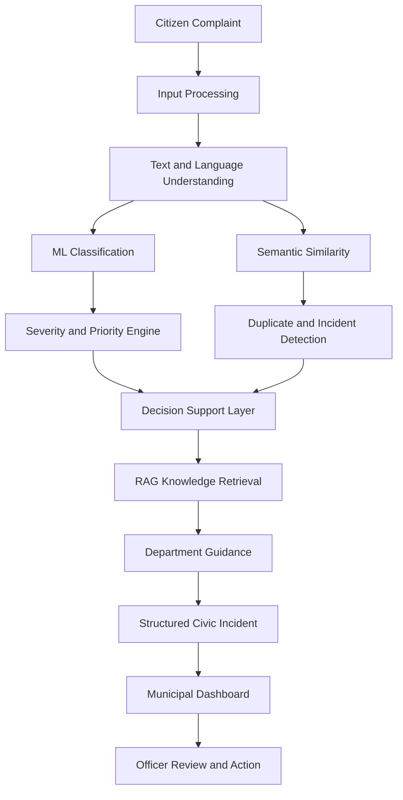
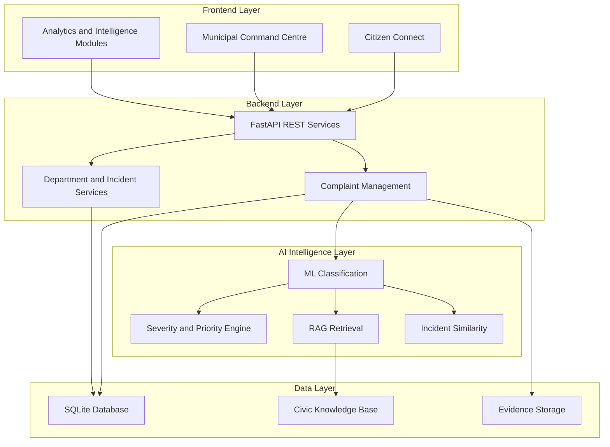

# CivicLens

# CivicLens — AI-Powered Civic Intelligence & Incident Response

<p align="center">
  <strong>See the problem. Understand the impact. Coordinate the response.</strong>
</p>

<p align="center">
  An intelligent civic complaint management and incident coordination platform that transforms scattered citizen reports into actionable insights for smarter, faster and more accountable urban governance.
</p>

---

## 1. The Problem

Cities receive thousands of complaints about everyday civic issues:

- Damaged roads and potholes.
- Overflowing garbage and sanitation problems.
- Water leakage and supply disruptions.
- Exposed electrical wires and power-related hazards.
- Fallen trees and damaged public infrastructure.
- Blocked drainage and urban waterlogging.

However, traditional complaint management systems face several challenges:

1. **Fragmented reporting:** Citizens report the same issue multiple times through different channels.
2. **Manual classification:** Authorities must manually identify the complaint category and responsible department.
3. **Poor prioritization:** Urgent safety hazards can get buried among routine complaints.
4. **Disconnected incidents:** Multiple complaints describing the same underlying problem are often treated independently.
5. **Limited coordination:** Different municipal departments may need to respond to one interconnected incident.
6. **Lack of accountability:** Citizens often have limited visibility into complaint progress and resolution.

The result is delayed responses, inefficient resource allocation and recurring civic problems.

## 2. Our Solution — CivicLens

CivicLens is an AI-powered civic intelligence and incident response platform designed to improve how cities understand, prioritize and resolve public infrastructure issues.

Instead of treating every complaint as an isolated ticket, CivicLens aims to understand the wider civic situation.

It combines:

- Artificial Intelligence and Machine Learning.
- Retrieval-Augmented Generation (RAG).
- Intelligent complaint classification.
- Severity and priority assessment.
- Duplicate complaint detection.
- Geospatial incident intelligence.
- Department coordination.
- Complaint lifecycle tracking.
- Data-driven civic analytics.

**Our central idea:** Move beyond complaint management towards intelligent incident management.

## 3. What Makes CivicLens Different?

| Traditional complaint system | CivicLens approach |
|---|---|
| Stores individual complaints | Connects potentially related complaints into incidents |
| Relies heavily on manual classification | Uses AI-assisted classification |
| Treats complaints with similar urgency | Separates hazard severity from operational priority |
| Assigns complaints to departments | Supports intelligent department recommendations |
| Shows individual complaint records | Adds geographic and incident-level intelligence |
| Focuses on closing tickets | Identifies recurring problems and potential preventive actions |
| Provides limited visibility | Aims to improve tracking and accountability |

CivicLens is designed to help authorities answer five important questions:

1. What is happening?
2. How serious is it?
3. Where is the impact concentrated?
4. Which departments need to respond?
5. Is this an isolated problem or part of a recurring civic issue?

---

## 4. Platform Modules

### 4.1 Command Centre — Unified Civic Dashboard

The central operational interface for municipal authorities.

Designed to provide:

- Total complaints received.
- Pending and unresolved complaints.
- Critical incident overview.
- Resolution statistics.
- Category-wise complaint distribution.
- Department workload.
- Recent complaint activity.
- Priority incidents requiring attention.

The goal is to provide officers with a quick overview of the city's civic situation.

### 4.2 Citizen Connect — Intelligent Complaint Submission

A citizen-facing complaint intake interface.

Designed to support:

- Complaint title and description.
- Civic issue category.
- Location information.
- Image and evidence uploads.
- Regional language selection.
- Automatic complaint ID generation.
- Complaint submission confirmation.
- Complaint status tracking.

The system aims to preserve the original citizen submission while creating a structured record for further analysis.

### 4.3 SenseAI — AI-Powered Complaint Understanding

SenseAI is the intelligence layer responsible for understanding unstructured civic complaints.

Its intended capabilities include:

- Complaint category classification.
- Understanding different complaint descriptions.
- Language-aware complaint processing.
- Contextual interpretation.
- AI-generated explanations.
- Confidence indicators.
- Recommended department identification.

For example:

A citizen reports:

*"There is a huge hole on the road near the school, and vehicles are swerving dangerously to avoid it."*

SenseAI should identify:
- Category: Roads and Infrastructure.
- Potential issue: Road damage.
- Context: Near a school.
- Recommended department: Roads and Infrastructure.

This transforms natural-language reports into structured civic information.

### 4.4 ImpactIQ — Severity and Priority Intelligence

Not every complaint has the same impact.

ImpactIQ is designed to assess the seriousness of a civic issue and determine how urgently it should be addressed.

It distinguishes two concepts:

**Severity:** How serious is the underlying hazard?

**Priority:** How urgently should the authority respond?

Potential assessment factors:

- Physical safety risk.
- Infrastructure damage.
- Public exposure.
- Location sensitivity.
- Number of related reports.
- Geographic spread.
- Duration unresolved.
- Recurrence.

Severity levels:

| Level | Meaning |
|---|---|
| Low | Minor issue with limited impact |
| Medium | Noticeable civic disruption |
| High | Significant public or infrastructure impact |
| Critical | Immediate or potentially serious safety hazard |

ImpactIQ is designed to provide an explanation alongside its assessment instead of producing an unexplained score.

Critical hazards should also be protected by deterministic safety rules rather than depending entirely on an AI-generated prediction.

### 4.5 CivicPulse — Incident Intelligence

One of CivicLens's key differentiating concepts.

Consider this situation:

- Five citizens report a pothole on the same road.
- Three more citizens report vehicle damage nearby.
- Another citizen reports traffic obstruction.

A traditional complaint system may create nine independent tickets.

CivicPulse aims to recognize that these reports may describe one underlying incident.

Its intended capabilities include:

- Similarity-based complaint comparison.
- Duplicate detection.
- Incident grouping.
- Related complaint identification.
- Incident timelines.
- Complaint count aggregation.
- Geographic hotspot identification.

Importantly, individual complaints are never deleted merely because they appear similar.

They remain separate citizen submissions while being linked to a common incident when appropriate.

### 4.6 CityVision — Geospatial Civic Intelligence

CityVision provides a geographic understanding of civic problems.

Designed capabilities:

- Interactive complaint map.
- Severity-based location markers.
- Category filters.
- Incident clusters.
- Complaint density visualization.
- Geographic hotspots.
- High-priority incident highlighting.

Instead of looking only at complaint counts, authorities can understand where problems are concentrated.

### 4.7 ResponseAI — Department Coordination

Many civic problems require more than one department.

For example:

A fallen tree damages an electrical line and blocks a road.

This may require coordination between:

- Electricity Department.
- Parks and Tree Management.
- Roads and Infrastructure.

ResponseAI is designed to recommend:

- Responsible departments.
- Required response actions.
- Multi-department coordination.
- Relevant operational guidance.
- Suggested resource allocation.

The objective is to support human decision-making, not replace authorized municipal officers.

### 4.8 ActionTracker — Complaint Lifecycle Management

ActionTracker provides visibility into the progress of civic complaints.

Proposed lifecycle:

`Submitted → AI Analysed → Assigned → In Progress → Resolved → Verified`

Capabilities include:

- Department assignment.
- Status updates.
- Complaint history.
- Resolution notes.
- Evidence uploads.
- Resolution tracking.
- Escalation recommendations.

### 4.9 CivicMemory — Recurring Problem Intelligence

A city should not repeatedly fix the same problem without understanding why it keeps returning.

CivicMemory aims to identify recurring civic issues.

Example:

If a particular drainage location repeatedly experiences blockages, CivicMemory can highlight the recurrence and recommend a permanent inspection rather than repeated temporary cleaning.

### 4.10 CivicSim — Response Scenario Simulation

CivicSim explores hypothetical response strategies.

For example:

- What if two repair teams are assigned instead of one?
- What if drainage and road teams respond together?
- Which response strategy could cover more incidents?

It is intended to compare estimated resource requirements, response scenarios and potential outcomes using transparent assumptions.

These are scenario estimates, not guaranteed real-world predictions.

### 4.11 Analytics & Reports

The analytics module aims to provide:

- Category-wise complaint trends.
- Department performance.
- Resolution time analysis.
- Pending complaint statistics.
- Geographic complaint distribution.
- Recurring issue patterns.
- Historical comparisons.

These insights can help authorities identify systemic problems and improve civic service delivery.

---

## 5. Technical Innovation — Hybrid ML + RAG Architecture

CivicLens is designed around a hybrid intelligence architecture.

Instead of relying entirely on a general-purpose language model, it separates classification, retrieval, safety rules and decision support.

### Why combine ML and RAG?

**Machine Learning (ML)** helps recognize patterns and classify complaints.

**Retrieval-Augmented Generation (RAG)** retrieves relevant information from a knowledge base before generating contextual guidance.

They solve different problems and complement one another.

### Proposed Processing Pipeline



### ML Engine

Responsible for:

- Complaint classification.
- Pattern recognition.
- Semantic similarity.
- Contextual matching.
- Incident relationship suggestions.

### RAG Engine

Responsible for retrieving relevant information from a curated civic knowledge base, such as:

- Department responsibilities.
- Complaint category definitions.
- Maintenance guidance.
- Emergency response procedures.
- Operational instructions.

The retrieved information provides context for explanations and response recommendations.

### Deterministic Safety Rules

Certain hazards should not depend entirely on probabilistic model outputs.

For example, a clearly reported exposed live electrical wire should trigger a critical safety assessment rule.

### Human-in-the-Loop Decision Making

AI outputs are recommendations.

Authorized officers should be able to review, correct and confirm classifications, incident groupings and department assignments.

This improves accountability and makes the platform more suitable for public-sector applications.

---

## 6. System Architecture

CivicLens follows a modular full-stack architecture.



The architecture is intended to keep the user interface, application services, intelligence components and persistent data logically separated.

---

## 7. Technology Stack

The project uses the following core technologies:

| Layer | Technology | Purpose |
|---|---|---|
| Frontend | React | Interactive user interface |
| Language | TypeScript | Type-safe frontend development |
| Frontend tooling | Vite | Development server and build tooling |
| Backend | Python FastAPI | REST API services |
| Database | SQLite | Persistent prototype data storage |
| AI/ML | Python ML ecosystem | Complaint classification and analysis |
| Retrieval | RAG-based knowledge retrieval | Contextual civic guidance |
| Visualization | Charts and mapping components | Civic analytics and geographic insights |

Additional libraries and model integrations depend on the actual implementation and available dependencies.

---

## 8. Example End-to-End Workflow

Consider a citizen submitting the following complaint:

*"A large tree has fallen near a residential road. It is blocking traffic and an electrical wire appears to be damaged."*

### Step 1 — Citizen Submission

The citizen submits the description and optionally attaches a photograph and location.

### Step 2 — SenseAI Analysis

The system identifies possible issues:

- Fallen tree.
- Road obstruction.
- Potential electrical hazard.

### Step 3 — ImpactIQ Assessment

The system recognizes a potential safety hazard and recommends urgent attention.

### Step 4 — RAG Retrieval

The system retrieves relevant departmental guidance for electrical hazards, road obstruction and fallen tree handling.

### Step 5 — CivicPulse

Related reports from nearby citizens can be identified and grouped into a common incident.

### Step 6 — CityVision

The incident appears on the geographic map with its associated reports and severity.

### Step 7 — ResponseAI

The platform recommends coordination between the relevant departments.

### Step 8 — ActionTracker

Officers update the incident as work progresses until the resolution is verified.

This demonstrates how CivicLens aims to connect citizen reporting, intelligent analysis and municipal response in one workflow.

---

## 9. Responsible AI and Reliability

CivicLens is designed with the following principles:

- Preserve original citizen-submitted information.
- Distinguish verified information from AI-generated recommendations.
- Provide explanations alongside predictions.
- Represent uncertainty rather than pretending every prediction is correct.
- Use deterministic safety rules for clearly hazardous situations.
- Keep human officers responsible for final operational decisions.
- Avoid treating duplicate reports as invalid submissions.
- Protect personal information and complaint evidence.
- Clearly label demonstration data and simulated scenarios.

---

## 10. Current Prototype Status

CivicLens is being developed as a hackathon prototype.

The project includes a frontend application, a backend foundation and an evolving intelligence architecture.

The implementation status should be evaluated module by module:

| Component | Prototype status |
|---|---|
| Frontend application and navigation | Implemented |
| Command Centre interface | Implemented; data integration to verify |
| Backend foundation and database | Implemented in development; runtime verification required |
| Citizen Connect | Developed; end-to-end testing required |
| SenseAI | Under integration and validation |
| ImpactIQ | Under integration and validation |
| RAG knowledge retrieval | Implementation and validation in progress |
| CivicPulse | Planned for next implementation phase |
| CityVision | Planned for next implementation phase |
| ResponseAI | Planned / under development |
| ActionTracker | Partial / under development |
| CivicMemory | Planned |
| CivicSim | Planned |
| Analytics and Reports | Interface foundation present; functional integration to verify |

**Note:** This is a development-status snapshot, not a claim that every listed module is production-ready. Features should be marked complete only after their backend integration and functionality have been tested.

---

## 11. Future Scope

CivicLens can be extended into a broader civic intelligence ecosystem.

Potential future enhancements:

- Multilingual voice-based complaint submission.
- WhatsApp and helpline integration.
- Advanced multimodal image and text understanding.
- Integration with real municipal infrastructure datasets.
- Real-time weather and seasonal risk context.
- Advanced geospatial analytics.
- Municipal ERP and work-order integration.
- Citizen feedback and resolution verification.
- Predictive maintenance using historical incident data.
- Secure public accountability dashboards.

---

## 12. Expected Impact

CivicLens aims to create value for three groups.

**Citizens**
- Easier complaint submission.
- Better visibility into complaint progress.
- Improved accountability.
- More accessible civic reporting.

**Municipal Officers**
- Reduced manual complaint classification.
- Better prioritization.
- Identification of related incidents.
- Improved departmental coordination.
- More structured operational information.

**Urban Administrators**
- Identification of recurring civic problems.
- Geographic understanding of civic issues.
- Data-driven resource planning.
- Better long-term infrastructure management.

Our long-term goal is to help cities move from reactive complaint handling towards proactive, coordinated civic governance.

---

## 13. Conclusion

Civic problems are rarely isolated.

A blocked drain can cause waterlogging. Waterlogging can disrupt traffic. A fallen tree can damage electrical infrastructure and obstruct roads.

Treating every report as a separate ticket misses the bigger picture.

**CivicLens aims to connect those reports, understand their impact and coordinate the response.**

It is not simply another complaint registration portal.

It is a proposed civic intelligence and incident coordination platform designed to make urban problem-solving more informed, connected and accountable.

---

<p align="center">
  <strong>CivicLens</strong><br/>
  See the problem. Understand the impact. Coordinate the response.
</p>


-----------------------------------------------------------------------------------------------------------------------------------------------------------
Local full-stack demo: React/TypeScript frontend, FastAPI backend, and persistent SQLite data. The seeded records are synthetic and labeled in the UI/API.

## Run the backend

```powershell
cd backend
python -m pip install -r requirements.txt
python -m uvicorn app.main:app --host 127.0.0.1 --port 8765 --reload
```

SQLite is initialized and seeded on startup at `backend/civiclens.db`. Set `DATABASE_URL` to use another SQLAlchemy-compatible database URL. CORS origins are configurable with `CORS_ORIGINS`.

## Run the frontend

In a second terminal:

```powershell
cd frontend
npm install
npm run dev -- --host 127.0.0.1 --port 5173
```

The frontend reads `VITE_API_BASE_URL` and defaults to `http://127.0.0.1:8765`. Run `npm run typecheck` and `npm run build` from `frontend/` to validate it.

Citizen Connect submits reports and optional JPEG/PNG/WebP evidence through the API. Images are stored as files under `backend/uploads/` (not in complaint text); the SQLite record stores a generated media reference. Citizen tickets use random IDs and can be looked up from the tracking panel. This prototype stores no citizen name or contact details and does not yet provide account authentication.
